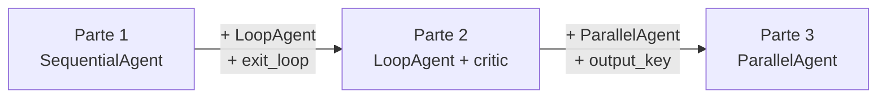

# Build Multi-Agent Systems with ADK

Este proyecto agrupa los ejercicios del laboratorio **"Build Multi-Agent Systems with ADK"** del programa GEAR (Gemini Enterprise Agent Ready) de Google. El laboratorio enseña a construir sistemas donde varios agentes colaboran, se transfieren el control y comparten estado a través de la sesión.

El laboratorio original se dividió en tres partes progresivas porque cada una introduce un patrón de orquestación distinto. Además incluye un módulo compartido (`parent_and_subagents`) que demuestra las transferencias básicas entre agente padre y sub-agentes.

## Estructura del proyecto

```
build_multi_agent_systems_with_adk/
├── README.md                          ← este archivo
├── callback_logging.py                ← callbacks de logging compartidos
├── requirements.txt                   ← dependencias adicionales (Wikipedia, LangChain)
├── adk_utils/                         ← plugin compartido para manejo de errores 429
│   ├── __init__.py
│   └── plugins.py
├── parent_and_subagents/              ← transferencias padre → sub-agentes (viajes)
│   ├── README.md
│   ├── agent.py
│   ├── __init__.py
│   └── .env
├── parte_1_sequential/                ← SequentialAgent: flujo lineal
│   ├── README.md
│   └── workflow_agents/
│       ├── agent.py
│       ├── __init__.py
│       └── .env
├── parte_2_loop/                      ← LoopAgent: ciclo iterativo con crítico
│   ├── README.md
│   └── workflow_agents/
│       ├── agent.py
│       ├── __init__.py
│       └── .env
└── parte_3_parallel/                  ← ParallelAgent: preproducción en paralelo
    ├── README.md
    └── workflow_agents/
        ├── agent.py
        ├── __init__.py
        └── .env
```

## Contenido

### `parent_and_subagents` — Transferencias entre agente padre y sub-agentes

Un agente `steering` transfiere la conversación hacia `travel_brainstormer` o `attractions_planner` según la intención del usuario. Demuestra cómo ADK usa las descripciones de los sub-agentes para dirigir el flujo.

→ [Ver detalle](./parent_and_subagents/README.md)

### Parte 1 — `SequentialAgent`: flujo lineal

Un `SequentialAgent` ejecuta tres agentes en orden fijo: investigar (Wikipedia) → escribir guión → guardar en archivo. No hay iteración ni paralelismo.

→ [Ver detalle](./parte_1_sequential/README.md)

### Parte 2 — `LoopAgent`: ciclo iterativo de mejora

Se introduce un agente `critic` y un `LoopAgent` que itera el ciclo investigar → escribir → criticar hasta que el resultado sea satisfactorio o se alcancen 5 iteraciones.

→ [Ver detalle](./parte_2_loop/README.md)

### Parte 3 — `ParallelAgent`: preproducción en paralelo

Sobre el flujo de la Parte 2, se añade un `ParallelAgent` con dos agentes que trabajan simultáneamente: uno analiza el potencial de taquilla y otro sugiere casting. El documento final integra los tres resultados.

→ [Ver detalle](./parte_3_parallel/README.md)

## Progresión del laboratorio



| Parte | Patrón añadido | Agentes nuevos | Herramientas nuevas |
| --- | --- | --- | --- |
| 1 | `SequentialAgent` | researcher, screenwriter, file_writer | `WikipediaQueryRun`, `append_to_state`, `write_file` |
| 2 | `LoopAgent` | critic | `exit_loop` |
| 3 | `ParallelAgent` | box_office_researcher, casting_agent | `output_key` |

## Código compartido

### `callback_logging.py`

Funciones `before_model_callback` y `after_model_callback` que registran en Cloud Logging las consultas al modelo y sus respuestas. Todos los agentes de todas las partes las utilizan.

### `adk_utils/plugins.py` — `Graceful429Plugin`

Plugin que intercepta errores HTTP 429 (cuota agotada) de la API y devuelve una respuesta de fallback en lugar de propagar la excepción. Incluye:

- `on_model_error` — hook estándar de ADK para capturar excepciones a nivel de modelo.
- `apply_429_interceptor` — wrapper que envuelve `generate_content_async` para capturar errores 429 reales.
- `apply_test_failover` — parchea el modelo para simular errores 429 durante testing.

### `requirements.txt`

Dependencias adicionales al ADK base:

```
langchain-community>=0.4.1
wikipedia>=1.4.0
```

## Configuración

### Variables de entorno

Cada sub-proyecto tiene un archivo `.env` (excluido de Git) con las siguientes variables:

```env
GOOGLE_GENAI_USE_VERTEXAI=TRUE
GOOGLE_CLOUD_PROJECT=tu-proyecto-gcp
GOOGLE_CLOUD_LOCATION=global
MODEL=gemini-2.0-flash
```

Si usas la API de Gemini en lugar de Vertex AI, reemplaza las variables por:

```env
GOOGLE_GENAI_USE_VERTEXAI=FALSE
GOOGLE_API_KEY=tu_clave
MODEL=gemini-2.0-flash
```

### Instalación de dependencias

Desde el directorio raíz del workspace:

```bash
source .venv/bin/activate
pip install google-adk -r build_multi_agent_systems_with_adk/requirements.txt
```

## Ejecución

Cada sub-proyecto se ejecuta de forma independiente con `adk run` o `adk web`:

```bash
# Transferencias padre/sub-agentes (viajes)
cd build_multi_agent_systems_with_adk
adk run parent_and_subagents

# Flujo secuencial (películas)
adk run parte_1_sequential/workflow_agents

# Ciclo iterativo con crítico
adk run parte_2_loop/workflow_agents

# Preproducción en paralelo
adk run parte_3_parallel/workflow_agents
```

O bien inicia la interfaz web para elegir cualquiera:

```bash
adk web
```

## Origen

Laboratorio **"Build Multi-Agent Systems with ADK"** del programa [GEAR (Gemini Enterprise Agent Ready)](https://cloud.google.com/gemini/gear) de Google Cloud. El laboratorio original se ejecuta en Cloud Shell con autenticación de Vertex AI; aquí se adapta para ejecución local.

