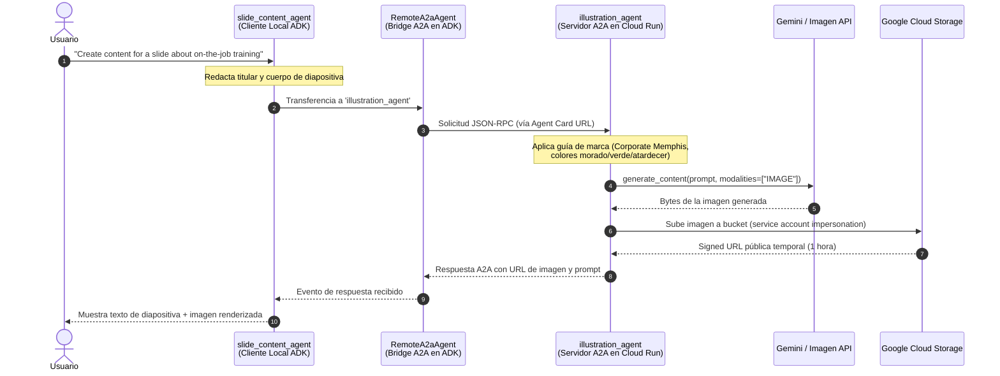

# Connect to Remote Agents with ADK and the Agent2Agent (A2A) SDK

Este proyecto reúne el código, la configuración y los artefactos del laboratorio **"Connect to Remote Agents with ADK and the Agent2Agent (A2A) SDK"** (código GENAI120), perteneciente al programa **GEAR (Gemini Enterprise Agent Ready)** de Google Cloud.

El objetivo central de este laboratorio es demostrar cómo conectar y orquestar agentes que residen en distintos servidores y entornos mediante el protocolo **Agent2Agent (A2A)**, permitiéndoles colaborar como microservicios independientes en lugar de compartir código o actuar como simples funciones locales.

---

## ¿Qué es el protocolo Agent2Agent (A2A)?

En arquitecturas de IA generativa complejas, compartir o copiar el código de un agente especializado entre múltiples equipos dificulta el mantenimiento, la gobernanza y las actualizaciones independientes. 

El protocolo **Agent2Agent (A2A)** resuelve este problema proporcionando un estándar abierto de comunicación entre agentes autónomos:

- **Comunicación estandarizada:** Utiliza JSON-RPC 2.0 sobre HTTP(S).
- **Descubrimiento mediante Agent Cards:** Cada agente describe públicamente sus habilidades, esquemas de entrada/salida, endpoints y metadatos en un archivo estandarizado (`agent.json`).
- **Intercambio enriquecido de datos:** Capacidad para transferir texto, esquemas estructurados en JSON y archivos binarios (imágenes, documentos).
- **Interacción flexible:** Soporta comunicación síncrona (request/response), streaming de respuestas vía SSE (Server-Sent Events) y notificaciones push asíncronas.
- **Integración nativa con ADK:** Mediante la clase `RemoteA2aAgent`, un agente de Google ADK puede tratar a un agente A2A remoto exactamente igual que a un sub-agente local (`sub_agents=[illustration_agent]`).

---

## Arquitectura del sistema

El proyecto implementa el caso de uso de una empresa de mantenimiento de estadios llamada **Cymbal Stadiums**:



---

## Estructura del proyecto

```
connect_to_remote_agents_with_adk_and_a2a/
├── README.md                          ← este archivo
├── requirements.txt                   ← dependencias del proyecto (google-adk[a2a], etc.)
├── illustration-agent-card.json       ← Agent Card que describe al agente remoto
│
├── illustration_agent/                ← Servidor A2A (generador de ilustraciones)
│   ├── agent.py                       ← lógica del agente y herramienta generate_image
│   ├── agent.json                     ← definición original del Agent Card
│   ├── requirements.txt               ← dependencias específicas de despliegue
│   ├── .env.example                   ← plantilla de variables de entorno
│   ├── .gitignore                     ← exclusión de secretos y base de datos local
│   ├── mock_images/                   ← imágenes de respaldo ante cuota agotada
│   │   ├── generated_image1.png
│   │   └── generated_image2.png
│   └── adk_utils/                     ← utilidades y plugins de resiliencia (429)
│       ├── __init__.py
│       ├── cached_responses.py
│       └── plugins.py
│
└── slide_content_agent/               ← Cliente ADK (generador de diapositivas)
    ├── agent.py                       ← agente que consume al RemoteA2aAgent
    ├── .env.example                   ← plantilla de variables de entorno
    ├── .gitignore                     ← exclusión de secretos y base de datos local
    └── adk_utils/                     ← utilidades y plugins de resiliencia
        ├── __init__.py
        ├── cached_responses.py
        └── plugins.py
```

---

## Componentes detallados

### 1. `illustration_agent` (Servidor A2A)

Es un microservicio independiente desarrollado con ADK y empaquetado para actuar como servidor A2A.

- **Directrices de marca:** Sus instrucciones fuerzan al modelo a seguir el estilo visual corporativo de *Cymbal Stadiums*: ilustración plana y geométrica (*Corporate Memphis*), paleta morada (`#BF40BF`), verde (`#DAF7A6`) y colores de atardecer, incorporando imaginería deportiva y de mantenimiento (herramientas, luces, césped, guantes).
- **Herramienta `generate_image`:**
  1. Invoca al modelo de imágenes (`IMAGE_MODEL=gemini-3.1-flash-image` o Imagen) con `aspect_ratio="1:1"`.
  2. Extrae los bytes de la imagen del objeto de respuesta.
  3. Impersona la cuenta de servicio (`illustration-agent-sa@...`) para subir los bytes al bucket de Google Cloud Storage (`{project_id}-bucket`).
  4. Genera y retorna una `Signed URL` segura con validez de 1 hora.
- **Agent Card (`agent.json`):**
  Declara el nombre, descripción, habilidades (`illustrate_text`) y la URL final donde queda alojado el servicio en Cloud Run (`https://illustration-agent-...run.app/a2a/illustration_agent`).

### 2. `slide_content_agent` (Cliente ADK con `RemoteA2aAgent`)

Es el agente con el que interactúa el usuario final para preparar diapositivas de presentación.

- Recibe una idea temática (por ejemplo: *"By supporting each other, we get big things done!"*).
- Redacta un titular conciso y 1 o 2 oraciones de texto descriptivo.
- Mediante la clase `RemoteA2aAgent`, lee el archivo `illustration-agent-card.json` para conocer las habilidades y la dirección del servidor remoto, y le transfiere el control para solicitar la ilustración complementaria.

### 3. Resiliencia y Fallbacks (`LabExUtils`)

Tanto el cliente como el servidor incorporan un plugin en `adk_utils/plugins.py` denominado `LabExUtils`. Este plugin implementa el hook `on_model_error_callback`: si se produce un error `HTTP 429 (RESOURCE_EXHAUSTED)` por saturación de cuota en el entorno de laboratorio, intercepta el fallo y devuelve de inmediato una respuesta de respaldo precalculada o imágenes mock locales (`mock_images/`).

---

## Despliegue y ejecución

### 1. Variables de entorno

Copia los archivos `.env.example` a `.env` dentro de `illustration_agent/` y `slide_content_agent/`:

```bash
cp illustration_agent/.env.example illustration_agent/.env
cp slide_content_agent/.env.example slide_content_agent/.env
```

Configura tus credenciales de Google Cloud Vertex AI o tu clave de API:

```env
GOOGLE_GENAI_USE_VERTEXAI=TRUE
GOOGLE_CLOUD_PROJECT=tu_proyecto_gcp
GOOGLE_CLOUD_LOCATION=global
MODEL=gemini-3.8-flash
IMAGE_MODEL=gemini-3.1-flash-image
```

### 2. Instalación de dependencias

Activa tu entorno virtual e instala los requerimientos:

```bash
source ../.venv/bin/activate
pip install -r requirements.txt
```

### 3. Probar el servidor de ilustración localmente

Puedes probar el agente de ilustración antes de desplegarlo ejecutando la interfaz web de ADK:

```bash
adk web
```

Accede a `http://localhost:8000`, selecciona `illustration_agent` y prueba una entrada como:
> *"By supporting each other, we get big things done!"*

### 4. Despliegue del servidor A2A en Google Cloud Run

El comando de ADK permite empaquetar y desplegar el agente en Cloud Run con un único comando utilizando la bandera `--a2a`:

```bash
adk deploy cloud_run \
    --project tu_proyecto_gcp \
    --region us-east4 \
    --service_name illustration-agent \
    --a2a \
    illustration_agent \
    -- \
    --service-account=illustration-agent-sa@tu_proyecto_gcp.iam.gserviceaccount.com \
    --set-env-vars="GOOGLE_CLOUD_LOCATION=global"
```

Al finalizar, Cloud Run proporcionará la URL del servicio (por ejemplo: `https://illustration-agent-xyz.run.app`). Esta URL debe reflejarse en `illustration-agent-card.json`.

### 5. Ejecutar el flujo completo de diapositivas

Con la Agent Card apuntando al servicio desplegado, inicia la interfaz web y selecciona `slide_content_agent`:

```bash
adk web
```

Envía una solicitud como:
> *"Create content for a slide about our excellent on-the-job training."*

El agente redactará el contenido y transferirá automáticamente la tarea al agente A2A remoto para devolver la imagen correspondiente.
