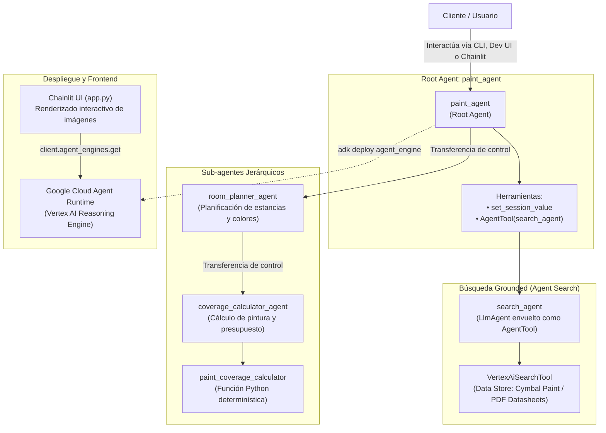

# Deploy an Agent with Agent Development Kit (ADK) Challenge Lab

Este proyecto contiene el código completo, la arquitectura y las soluciones implementadas para el laboratorio de evaluación final (**Challenge Lab GENAI129**) del programa **GEAR (Gemini Enterprise Agent Ready)** de Google Cloud, mediante el cual se obtiene la **Skill Badge** oficial de desarrollo y despliegue de agentes con ADK.

A diferencia de los laboratorios guiados paso a paso, este desafío presenta un escenario del mundo real con un código base incompleto y con errores que deben diagnosticarse, corregirse, enriquecerse con estado compartido, conectarse a búsqueda empresarial y desplegarse en producción en **Agent Runtime (Vertex AI Reasoning Engines)** con un frontend web interactivo construido en **Chainlit**.

---

## Escenario del desafío: Cymbal Shops Paint Department

**Cymbal Shops** es una cadena minorista que expande sus operaciones a Europa con un nuevo departamento de pinturas para proyectos de bricolaje (DIY). El objetivo es poner en producción a **Paint Agent**, un asistente conversacional capaz de:

1. **Recomendar productos de pintura:** Consultar fichas técnicas corporativas indexadas en Google Agent Search (*Cymbal Paint*).
2. **Gestionar la selección y estado:** Guardar el producto elegido (`SELECTED_PAINT`), su rendimiento (`COVERAGE_RATE`) y su precio (`PRICE`) en el estado de la sesión.
3. **Planificar habitaciones y colores:** Guiar al cliente en la elección de colores por habitación y desplegar imágenes de muestra (*swatches*).
4. **Calcular superficies y pintura requerida:** Recibir dimensiones (largo, ancho, alto), descontar puertas y ventanas, estimar capas y calcular los botes de 2.5L necesarios junto con el costo total.

---

## Arquitectura del sistema multi-nivel

El sistema implementa una jerarquía de agentes combinada con búsqueda y herramientas determinísticas:



---

## Retos técnicos y soluciones del Challenge Lab

### 1. Resolución del conflicto de herramientas de búsqueda (`INVALID_ARGUMENT`)
- **Problema encontrado:** Al iniciar el agente y preguntar por productos, la API de Gemini arrojaba el error:
  ```
  google.genai.errors.ClientError: 400 INVALID_ARGUMENT: Multiple tools are supported only when they are all search tools.
  ```
  Esto ocurre porque un agente no puede combinar herramientas de búsqueda (`VertexAiSearchTool`) con herramientas de función o con transferencias implícitas (`transfer_to_agent`) hacia sub-agentes en una misma llamada.
- **Solución aplicada:** Se aisló `search_agent` y se envolvió utilizando la clase `AgentTool`:
  ```python
  tools=[
      set_session_value,
      AgentTool(agent=search_agent, skip_summarization=False),
  ]
  ```
  De esta forma, `search_agent` actúa como una herramienta para el `root_agent` en lugar de un sub-agente directo, permitiendo convivir con otras herramientas sin violar las restricciones del modelo.

### 2. Implementación de estado compartido de sesión
- **Herramienta `set_session_value`:** Se completó la función en `tools.py` para almacenar dinámicamente datos clave en `tool_context.state[key] = value`:
  ```python
  async def set_session_value(tool_context: ToolContext, key: str, value: str):
      tool_context.state[key] = value
      return {"status": f"stored '{value}' in '{key}'"}
  ```
- **Sintaxis de plantillas opcionales:** En `coverage_calculator_agent` se corrigieron las instrucciones para interpolar los valores acumulados en la sesión (`{SELECTED_PAINT?}`, `{COVERAGE_RATE?}`, `{PRICE?}`), evitando fallos si el agente es invocado antes de poblar alguna variable.

### 3. Cálculo de cobertura y rendimiento
La herramienta `paint_coverage_calculator` calcula el área total de las paredes restando el área estándar de puertas ($1.9\,\text{m}^2$) y ventanas ($1.4\,\text{m}^2$). Con el rendimiento del producto seleccionado (`COVERAGE_RATE`), calcula los litros requeridos y redondea a botes de $2.5\,\text{L}$.

### 4. Despliegue en Agent Runtime y frontend Chainlit
- **Agent Runtime:** Empaquetado y subida a Google Cloud Vertex AI Reasoning Engines mediante:
  ```bash
  adk deploy agent_engine --display_name "Paint Agent" paint_agent
  ```
- **Chainlit UI (`chainlit_ui/app.py`):** Frontend conversacional que se conecta al Reasoning Engine desplegado, maneja sesiones asíncronas con streaming (`agent.async_stream_query`) y parsea dinámicamente etiquetas HTML `` para desplegar muestras de color directamente en el chat.

---

## Estructura del proyecto

```
deploy_agent_with_adk_challenge_lab/
├── README.md                          ← este archivo
├── requirements.txt                   ← dependencias (google-cloud-aiplatform, chainlit, etc.)
├── test_adk.py                        ← script de prueba rápida para streaming de ADK
├── .env.example                       ← plantilla general de variables de entorno
├── .gitignore                         ← exclusión de secretos y datos locales
│
├── paint_agent/                       ← Agente principal y sub-agentes
│   ├── agent.py                       ← root_agent (paint_agent) configurado con AgentTool
│   ├── tools.py                       ← set_session_value para persistencia de estado
│   ├── callback_logging.py            ← registro de eventos en Cloud Logging
│   ├── requirements.txt               ← dependencias de empaquetado para Agent Runtime
│   ├── .env.example                   ← plantilla de credenciales del agente
│   ├── .gitignore
│   └── sub_agents/
│       ├── search_agent/              ← agente especializado en Vertex AI Search
│       │   ├── __init__.py
│       │   └── agent.py
│       └── room_planner/              ← sub-agente para selección de habitaciones y color
│           ├── __init__.py
│           ├── agent.py
│           └── sub_agents/
│               └── coverage_calculator/ ← sub-agente de cálculo métrico y presupuesto
│                   ├── __init__.py
│                   ├── agent.py
│                   └── tools.py
│
└── chainlit_ui/                       ← Interfaz web de usuario
    ├── app.py                         ← cliente Chainlit conectado a Agent Runtime
    ├── chainlit.md                    ← pantalla de bienvenida de Chainlit
    ├── .env.example
    ├── .gitignore
    ├── .chainlit/config.toml          ← configuración de tema y traducción
    └── public/                        ← recursos visuales (logos, paletas swatches.svg)
```

---

## Configuración y ejecución

### 1. Variables de entorno

Copia las plantillas `.env.example` a `.env`:

```bash
cp .env.example .env
cp paint_agent/.env.example paint_agent/.env
cp chainlit_ui/.env.example chainlit_ui/.env
```

Configura tus variables en `.env`:

```env
GOOGLE_GENAI_USE_VERTEXAI=TRUE
GOOGLE_CLOUD_PROJECT=tu_id_de_proyecto_gcp
GOOGLE_CLOUD_LOCATION=us-central1
RESOURCES_BUCKET=tu_bucket_de_recursos
MODEL=gemini-2.5-flash
SEARCH_ENGINE_ID=tu_search_engine_id_de_agent_search
AGENT_RESOURCE_NAME=projects/tu_id/locations/us-central1/reasoningEngines/tu_engine_id
```

### 2. Instalación de dependencias

Activa tu entorno virtual e instala los requerimientos:

```bash
source ../.venv/bin/activate
pip install -r requirements.txt
```

### 3. Pruebas locales con ADK

Puedes ejecutar el agente en modo consola o mediante la interfaz de desarrollo de ADK:

```bash
# Modo consola interactiva
adk run paint_agent

# Interfaz web de desarrollo
adk web
```

### 4. Despliegue en Google Cloud Agent Runtime

Para desplegar el agente en Vertex AI Reasoning Engines:

```bash
adk deploy agent_engine --display_name "Paint Agent" paint_agent
```

Al finalizar, la consola mostrará el `resource_name` del agente desplegado (por ejemplo: `projects/123.../locations/us-central1/reasoningEngines/456...`). Coloca este identificador en `chainlit_ui/.env` como `AGENT_RESOURCE_NAME`.

### 5. Iniciar la aplicación Chainlit

Para interactuar con el agente en la interfaz web personalizada:

```bash
cd chainlit_ui
chainlit run app.py
```

Abre `http://localhost:8000` en tu navegador.

---

## Conversación de prueba de punta a punta

| Paso | Entrada del Usuario | Comportamiento esperado de Paint Agent |
| :--- | :--- | :--- |
| **1** | `hello` | Da la bienvenida a Cymbal Shops y ofrece asesoramiento sobre pinturas. |
| **2** | `yes` | Consulta Agent Search vía `search_agent` y describe *Project Paint*, *EcoGreens*, *SureCoverage* y *Forever Paint* con precios y cobertura. |
| **3** | `I'd like to use EcoGreens` | Almacena `SELECTED_PAINT`, rendimiento y precio en el estado de sesión; transfiere a `room_planner_agent`. |
| **4** | `Just one room, my office` | Muestra la paleta de colores disponibles para *EcoGreens* con imágenes. |
| **5** | `Deep Ocean` | Confirma el color y pide las dimensiones de la habitación. |
| **6** | `3m by 4m. 3m high. 1 door, 2 windows.` | Transfiere a `coverage_calculator_agent`, invoca `paint_coverage_calculator` y pregunta cuántas capas se aplicarán. |
| **7** | `Two coats.` | Calcula la superficie neta ($74\,\text{m}^2$), los litros necesarios, los botes de $2.5\,\text{L}$ y el presupuesto total final. |
