# Use Model Context Protocol (MCP) Tools with ADK Agents

Este proyecto reúne el código, la configuración y los ejemplos prácticos del laboratorio **"Use Model Context Protocol (MCP) Tools with ADK Agents"** (código GENAI124), perteneciente al programa **GEAR (Gemini Enterprise Agent Ready)** de Google Cloud.

El objetivo central es aprender a integrar el estándar abierto **Model Context Protocol (MCP)** en agentes desarrollados con **Google Agent Development Kit (ADK)**, abordando los dos patrones de integración fundamentales: consumir herramientas desde un servidor MCP remoto existente (ADK como cliente) y construir un servidor MCP propio que expone herramientas nativas de ADK a cualquier cliente compatible.

---

## ¿Qué es Model Context Protocol (MCP)?

**Model Context Protocol (MCP)** es un protocolo abierto diseñado para estandarizar la forma en que los Modelos de Lenguaje Grande (LLMs) interactúan con aplicaciones, datos y herramientas externas. Actúa como una capa universal de conexión que simplifica el acceso a contexto y ejecución de acciones.

MCP opera bajo una arquitectura **cliente-servidor**:
- **Servidor MCP:** Expone recursos (*resources*), plantillas interactivas (*prompts*) y funciones ejecutables (*tools*).
- **Cliente MCP:** Aplicación host o agente de IA que descubre dinámicamente y consume las capacidades del servidor mediante un protocolo estandarizado (JSON-RPC sobre `stdio` o `HTTP/SSE`).

---

## Los 2 patrones de integración implementados

```mermaid
flowchart TD
    subgraph Patron1["Patrón 1: ADK como Cliente MCP"]
        A1["Usuario / Dev UI"] --> B1["maps_assistant_agent<br/>(LlmAgent en ADK)"]
        B1 --> C1["MCPToolset<br/>(StreamableHTTPConnectionParams)"]
        C1 -->|"HTTP + OAuth Token<br/>(maps_auth_headers)"| D1["Servidor MCP Remoto de Google Maps<br/>(Maps Grounding Lite API)"]
        D1 -->|"Descubrimiento dinámico"| E1["search_places<br/>compute_routes"]
    end

    subgraph Patron2["Patrón 2: Servidor MCP exponiendo herramientas ADK"]
        A2["Usuario / Dev UI"] --> B2["web_reader_mcp_client_agent<br/>(LlmAgent en ADK)"]
        B2 --> C2["MCPToolset<br/>(StdioConnectionParams)"]
        C2 -->|"Subproceso stdio<br/>(python3 adk_server.py)"| D2["Servidor MCP Custom (adk_server.py)<br/>mcp.server.lowlevel.Server"]
        D2 -->|"Envuelve y ejecuta"| E2["Herramienta ADK: load_web_page"]
        D2 -.->|"Logs desacoplados"| F2["mcp_server.log"]
    end
```



---

## Estructura del proyecto

```
use_mcp_tools_with_adk_agents/
├── README.md                          ← este archivo
├── requirements.txt                   ← dependencias (google-adk[otel-gcp], lxml, etc.)
├── callback_logging.py                ← callbacks para registro de consultas en Cloud Logging
├── adk_utils/                         ← plugin de resiliencia y respuestas en caché (429)
│   ├── __init__.py
│   ├── cached_responses.py
│   └── plugins.py
│
├── google_maps_mcp_agent/             ← Patrón 1: Cliente MCP de Google Maps
│   ├── agent.py                       ← agente con MCPToolset hacia servidor Maps remoto
│   ├── __init__.py
│   ├── .env.example                   ← plantilla de variables de entorno
│   └── .gitignore                     ← exclusión de credenciales locales
│
└── adk_mcp_server/                    ← Patrón 2: Servidor MCP custom con herramientas ADK
    ├── adk_server.py                  ← servidor MCP que expone load_web_page vía stdio
    ├── agent.py                       ← agente cliente que consume el servidor local
    ├── __init__.py
    ├── .env.example                   ← plantilla de variables de entorno
    └── .gitignore                     ← exclusión de credenciales y mcp_server.log
```

---

## Detalle de los componentes

### 1. `google_maps_mcp_agent` (Patrón 1: Cliente MCP Remoto)

Integra herramientas de geolocalización desde el servidor remoto alojado por Google (**Maps Grounding Lite**):

- **Descubrimiento dinámico de herramientas:** El agente no declara manualmente las herramientas de mapas; al inicializarse, el `MCPToolset` consulta al servidor MCP (`list_tools`) y adapta automáticamente herramientas como `search_places` y `compute_routes` a tipos `BaseTool` de ADK.
- **Autenticación dinámica (`maps_auth_headers`):** El servidor MCP de Maps requiere un token OAuth con el scope `https://www.googleapis.com/auth/maps-platform.mapstools`. La función proveedora de encabezados se encarga de refrescar el token de la cuenta de servicio impersonada antes de cada llamada:
  ```python
  tools=[
      MCPToolset(
          connection_params=StreamableHTTPConnectionParams(
              url="https://mapstools.googleapis.com/mcp",
              timeout=15,
          ),
          header_provider=maps_auth_headers,
      )
  ]
  ```

### 2. `adk_mcp_server` (Patrón 2: Servidor MCP exponiendo herramientas ADK)

Construye un puente para que herramientas nativas de ADK puedan ser aprovechadas por cualquier cliente MCP:

- **Servidor MCP (`adk_server.py`):**
  - Instancia un servidor MCP de bajo nivel (`mcp.server.lowlevel.Server`).
  - Envuelve la herramienta nativa `load_web_page` con `FunctionTool` y la adapta al esquema de MCP con `adk_to_mcp_tool_type`.
  - Escucha conexiones en entrada/salida estándar (`mcp.server.stdio.stdio_server`).
  - Separa los registros de depuración enviándolos a `mcp_server.log` para no corromper los mensajes JSON-RPC que viajan por `stdout`.
- **Agente cliente (`agent.py`):**
  - Utiliza `StdioConnectionParams` para lanzar `adk_server.py` como un subproceso de Python de forma transparente.
  - Aplica `tool_filter=['load_web_page']` para restringir la exposición únicamente a la herramienta deseada.

### 3. Resiliencia ante cuotas (`adk_utils` con `LabExUtils`)

Ambos agentes incorporan el plugin `LabExUtils`, el cual captura excepciones `HTTP 429 (RESOURCE_EXHAUSTED)` y suministra respuestas contextuales cacheadas para permitir continuar las pruebas sin interrupciones durante picos de demanda.

---

## Configuración y ejecución

### 1. Variables de entorno

Copia los archivos `.env.example` a `.env` dentro de cada subproyecto:

```bash
cp google_maps_mcp_agent/.env.example google_maps_mcp_agent/.env
cp adk_mcp_server/.env.example adk_mcp_server/.env
```

Configura tus credenciales del proyecto de Google Cloud con Vertex AI:

```env
GOOGLE_GENAI_USE_VERTEXAI=TRUE
GOOGLE_CLOUD_PROJECT=tu_proyecto_gcp
GOOGLE_CLOUD_LOCATION=global
MODEL=gemini-3.5-flash
OTEL_INSTRUMENTATION_GENAI_CAPTURE_MESSAGE_CONTENT=true
```

### 2. Instalación de dependencias

Activa tu entorno virtual e instala los requisitos:

```bash
source ../.venv/bin/activate
pip install -r requirements.txt
```

### 3. Ejecución de la interfaz de desarrollo (ADK Dev UI)

Inicia el servidor de desarrollo de ADK desde el directorio raíz del proyecto:

```bash
adk web
```

Abre `http://localhost:8000` en tu navegador.

---

## Pruebas sugeridas

### Probando `google_maps_mcp_agent`

Selecciona `google_maps_mcp_agent` en el selector de agentes e interactúa en una misma sesión:

1. **Búsqueda de lugares:**
   > *"Find some highly rated coffee shops near the Googleplex in Mountain View."*
   *(El agente llama a `search_places` y lista los resultados).*

2. **Cálculo de rutas usando contexto previo:**
   > *"How far is it, and how long does it take, to drive from the highest rated one to San Francisco International Airport (SFO)?"*
   *(El agente deduce la cafetería de la respuesta anterior e invoca `compute_routes`).*

3. **Comparación de distancias:**
   > *"Which is closer to the Googleplex by car: San Francisco International Airport (SFO) or San Jose International Airport (SJC)?"*

### Probando `adk_mcp_server`

1. En una terminal independiente, puedes monitorear el log del servidor MCP:
   ```bash
   tail -f adk_mcp_server/mcp_server.log
   ```
2. En la interfaz web de ADK, selecciona el agente `adk_mcp_server` (denominado internamente `web_reader_mcp_client_agent`).
3. Envía una solicitud de lectura web:
   > *"Load the content from http://example.com."*
4. Observa cómo el agente levanta el subproceso `adk_server.py`, el servidor ejecuta `load_web_page`, registra la actividad en `mcp_server.log` y retorna el contenido de la página web al agente.
